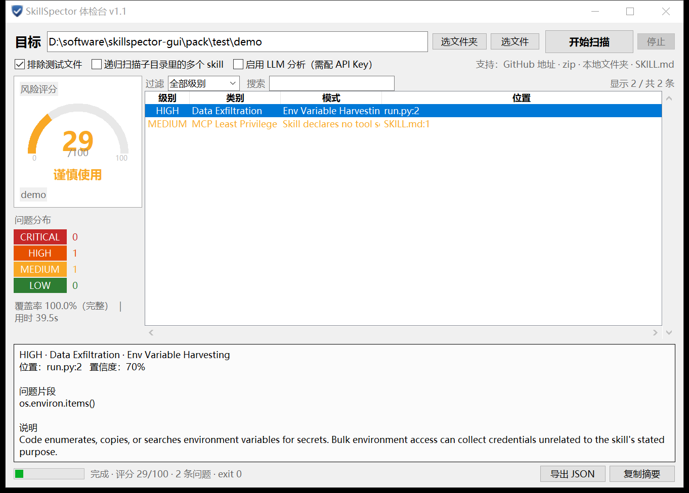

# SkillSpector 体检台

给 AI Agent 的 **skill（技能包）做安全体检**的图形界面。

填一个 GitHub 地址、本地文件夹或 zip，它告诉你这个 skill 里有没有偷凭据、往外发数据、提权、提示词注入这类问题——装之前先看一眼。

底层扫描内核是 NVIDIA 开源的 [skillspector](https://github.com/NVIDIA/skillspector)（Apache-2.0）；本仓库是它的 Windows 图形外壳 + 便携打包。



## 快速开始

1. 下载本仓库（右上角 **Code → Download ZIP**）
2. 解压到任意目录（**别在压缩包预览窗口里直接运行**）
3. 双击 **`安装.bat`**，等 1–2 分钟
4. 桌面出现「SkillSpector 体检台」，双击即可用

安装到 `%LOCALAPPDATA%\SkillSpector\`，**全程离线、不需要管理员权限、不需要自己装 Python**。

> 系统要求：64 位 Windows 10 及以上。
>
> 首次运行如果弹出「Windows 已保护你的电脑」，点「更多信息 → 仍要运行」——程序没有代码签名，属于正常现象。

## 怎么用

在「目标」里填：

- `https://github.com/某某/某某-skill` — Git 仓库
- `C:\path\to\skill` — 本地文件夹
- `某个.zip` — 压缩包

点「开始扫描」。评分含义：

| 分数 | 结论 |
| --- | --- |
| 0–20 | 安全，可以装 |
| 21–50 | 谨慎 |
| 51–80 | 不要装 |
| 81–100 | 严重，别装 |

下方详情会给出问题片段、说明和修复建议。第一次扫描要加载规则，1–3 分钟属正常，状态栏有已用时，随时可停。

## 目录结构

```
安装.bat            双击安装
检查环境.bat        逐项自检（出问题先跑这个）
卸载.bat            连快捷方式一起清理
先读我.txt          给使用者看的说明
app/                界面程序（SkillSpector-GUI.exe）
payload/            便携引擎：python.zip（运行时）+ engine.zip（依赖）
scripts/            安装 / 检测 / 卸载的 PowerShell 脚本
src/                界面源码与图标脚本
```

## 源码

界面是单文件 tkinter 程序：`src/skillspector_gui.py`，打包用 PyInstaller：

```bat
pyinstaller --noconfirm --onefile --windowed --name SkillSpector-GUI ^
  --icon icon.ico --add-data "icon.ico;." skillspector_gui.py
```

图标由 `src/make_icon.py` 生成（Pillow），改配色后重跑即可。

命令行也支持：

```bat
SkillSpector-GUI.exe "C:\path\to\skill"      :: 启动即扫
SkillSpector-GUI.exe --report report.json    :: 回看已扫好的报告
```

## 说明

静态分析有一定误报率，看到问题别慌，先点进去看「问题片段」和「说明」。
扫描规则与判断均来自 skillspector 本体，本仓库不修改其检测逻辑。
